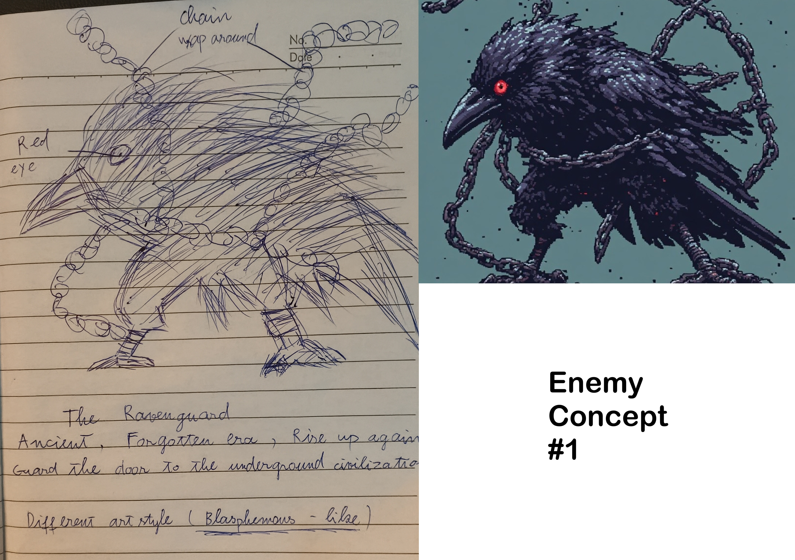

# NEON SIN

A 2D side-scrolling game developed with **Godot Engine**.

This project is created as a game development learning project, focusing on gameplay programming, character movement, combat, UI/HUD, enemy and boss systems, and overall game design.

## 📖 Story & Setting

The story takes place in a high-tech cyberpunk city, where neon lights illuminate every corner and its inhabitants are humanoid animal people.

<table>
  <tr>
    <td width="40%" align="center">
      
      <br><b>Player Concept #1</b>
    </td>
    <td>
      <h3>The Protagonist</h3>
      The protagonist is a pink/white cat who always wears a purple hoodie. He is a petty thief and pickpocket, living from day to day by stealing whatever he can to survive.
    </td>
  </tr>
  <tr>
    <td>
      <h3>The Encounter</h3>
      One night, while passing through a dark alley, he notices a shadowy figure digging through a dumpster. The moment the creature hears him, a pair of glowing red eyes turns toward him.
      <br><br>
      Emerging from the darkness is a gigantic crow-like creature, its entire body wrapped in heavy chains. It is wild and ferocious, seemingly something that doesn't belong to this era. The creature lets out a terrifying roar and charges at him. But thanks to the agility of a cat and the quick hands of an experienced rogue, he manages to take the creature down.
    </td>
    <td width="40%" align="center">
      
      <br><b>Enemy Concept #1</b>
    </td>
  </tr>
</table>

## 🎮 Features

* 2D side-scrolling gameplay with movement, jump, run and dash
* Combat system with hit feedback (knockback, control stun, death)
* Boss AI (detection, chase, attack with cooldown) and boss HP bar
* Stamina and HP systems with player HUD
* Main menu with animated background
* Pause menu (resume / settings / quit / main menu)
* Settings screen (Music / SFX / Voice volume, saved to file)
* Audio system (music, sound effects, voice channels)
* Dialogue system (typewriter text, branching choices, portraits)
* Pixel-art based visual style

## 🛠️ Built With

* **Godot Engine**
* **GDScript**
* 2D / CanvasLayer UI
* Pixel Art

## 📁 Project Structure 

```text
neon-sin/
├── art/                  # Sprites, UI assets, menu assets, bitmap fonts
├── audio/                # Music and sound effects
│   ├── music/
│   └── sfx/
├── scenes/
│   ├── enemies/          # Enemy scenes
│   ├── levels/           # Level scenes
│   ├── menu/             # Main menu, pause, settings scenes
│   ├── player/           # Player scene
│   └── ui/               # HUD, boss HUD, dialogue UI
├── scripts/
│   ├── dialogue/         # Dialogue engine, UI, conversation data
│   ├── enemies/          # Enemy AI
│   ├── levels/           # Level scripts
│   ├── player/           # Player controller
│   └── ui/               # Menu, HUD scripts
├── default_bus_layout.tres
├── project.godot
├── AGENTS.md
└── README.md
```

## 🎯 Current Development

The project is currently under development.

### Implemented

* [x] Player movement, jump, run and dash
* [x] Stamina and HP systems with player HUD
* [x] Player combat, damage / hit system and death system
* [x] Boss AI with HP bar
* [x] Main menu with animated background
* [x] Pause menu (Escape) and settings screen shared by both menus
* [x] Audio system: looping music, attack voice and hit SFX
* [x] Dialogue system: typewriter box with portraits, branching choices (J to advance, W/S to pick), tree pauses during a conversation

### In Progress

* [ ] Level design
* [ ] Checkpoint system
* [ ] Game progression
* [ ] Visual effects (VFX)
* [ ] More enemies and boss variety
* [ ] Dialogue story content (branch copy still placeholder)
* [ ] Human visual pass on the dialogue UI

## 🚀 Running the Project

### Requirements

* Godot Engine 4.x

### Steps

1. Clone the repository:

```bash
git clone https://github.com/namtit2932k/neon-sin.git
```

2. Open **Godot Engine**.

3. Select **Import**.

4. Choose the project's `project.godot` file.

5. Press **F6** to run the current scene or **F5** to run the main project.

## 🎮 Controls

| Action | Key |
|---|---|
| Move left / right | `A` / `D` |
| Jump | `Space` |
| Dash (tap) | `Shift` |
| Run (hold) | `Shift` |
| Attack | `J` |
| Pause / resume (in level) | `Escape` |
| Dialogue: advance / confirm | `J` |
| Dialogue: choose option | `W` / `S` |

During a dialogue the level pauses (music keeps playing); `Escape` is
swallowed so the pause menu cannot open mid-dialogue.

## 🎨 Development Goals

The main goals of this project are:

* Learn and practice Godot Engine
* Improve gameplay programming skills
* Learn game systems design
* Practice UI/HUD implementation
* Build a complete playable prototype
* Create a portfolio project demonstrating game development skills

## 📌 Status

**In Development**

More gameplay systems, content, visual effects, and polish will be added as development continues.

## 📄 License

This project is currently intended for learning and portfolio purposes.
